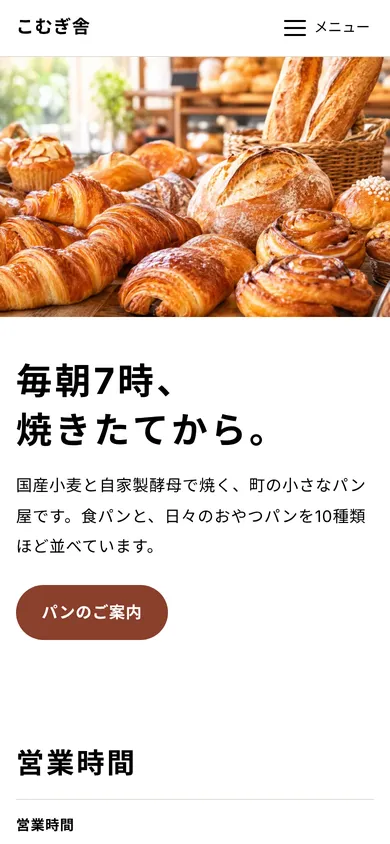

# chibiweb

**WordPressを入れるほどでもないサイトのために。**

v0.1.0（α版）　｜　デモ：[chibiweb.piemx.net](https://chibiweb.piemx.net/)



chibiweb（ちびウェブ）は、小さなお店や団体のための、小さなウェブ一式です。お知らせだけを更新できる小さなCMSと、静的サイトのひな形、AIと一緒に直すための説明書が入っています。

chibiwebには、2つの約束があります。

1. **小さいままでいる**。サイトは「どんな店か」と「どこにあるか」を伝える場所。毎日の写真や商品はSNSに任せ、通販や予約などの大きな機能は入れない
2. **静的HTMLをAIで更新することを基本に、ブログの構造は最小単位だけ持つ**。ページはただのHTMLで、AIと話しながら直す。日付順・1件ずつ・下書き・予約公開といったブログの構造を持つのは、お知らせだけ

> **はじめに読んでほしいもの**
> - [chibiwebで、小さなお店のサイトを預かる人へ](docs/FOR-MAKERS.md)：ソフトウェアの中には書けない、使い方の考え方
> - [chibiwebで、自分のテーマをつくる人へ](docs/FOR-DESIGNERS.md)：どのファイルのどこを直せば、オリジナルのテーマがつくれるか
> - [chibiwebをフォーク・改造するエンジニアへ](docs/FOR-ENGINEERS.md)：お知らせのしくみの仕様書（データ形式、設定、API、部品）

> これはα版です。仕様は変わります。試して、気づいたことを教えてください。参加のしかたは [CONTRIBUTING.md](CONTRIBUTING.md) へ。

見本の中身は、架空の町のパン屋「こむぎ舎」です。メイン写真は画像生成AIで作ったもので、実在のお店や商品ではありません。営業時間、商品と値段、臨時休業のお知らせ、教室の告知と、小さなお店のサイトに必要なものをひととおり入れています。

## 何が入っているか

```
chibiweb/
├─ public/              ← サーバーに上げるもの（この中身をサイトのフォルダへ）
│   ├─ index.html       トップページの見本
│   ├─ menu.html        下層ページの見本（表・箇条書き・注意書き）
│   ├─ about.html       下層ページの見本（情報リスト・見出し・引用）
│   ├─ news.html        お知らせ一覧ページの見本
│   ├─ site.json        サイト名・ロゴ・メニュー・コピーライト
│   ├─ assets/
│   │   ├─ style.css    見た目（色や文字は先頭の変数で変える）
│   │   ├─ site.js      ヘッダー・フッターの部品
│   │   └─ img/         メイン写真（3サイズ）
│   └─ news/            ← ここが「core」（お知らせCMS本体）
│       ├─ admin/       管理画面
│       ├─ api.php      お知らせをJSONで返す
│       ├─ embed.js     ページに貼る部品
│       ├─ config.php   チャンネル（お知らせの種類）などの設定
│       ├─ lib.php
│       └─ data/        お知らせ本体（1件＝1つの .md ファイル）
├─ docs/                ← 説明（サーバーには上げない）
│   ├─ FOR-MAKERS.md    サイトを預かる人へ（このプロジェクトの考え方）
│   ├─ FOR-DESIGNERS.md 自分のテーマをつくる人へ
│   ├─ FOR-ENGINEERS.md フォーク・改造するエンジニアへ（仕様書）
│   ├─ HOW-IT-WORKS.md  しくみの解説（画像つき）
│   ├─ DESIGN.md        デザインのルール
│   ├─ CONTENT.md       ページ一覧と文章のルール
│   └─ img/             説明用の画像
├─ photos/              写真の元データ（サーバーには上げない）
├─ README.md            この説明
├─ AGENTS.md            AIへの作業ルール
├─ CLAUDE.md            Claude用の入口（AGENTS.md を読むだけ）
├─ CONTRIBUTING.md      参加のしかた
├─ CODE_OF_CONDUCT.md   行動規範
├─ CHANGELOG.md         変更の記録
└─ LICENSE
```

- **core**（`public/news/`）：お知らせCMS。これだけ別のサイトに置いても使えます
- **kit**（`public/` のそれ以外）：静的サイトのひな形
- **docs**：人とAIのための説明書。しくみは `docs/HOW-IT-WORKS.md` から

## 動かすのに必要なもの

- PHP 8.1 以上が動くレンタルサーバー（Xサーバー、さくら、ロリポップなど）
- データベースは不要です
- Apache（日本のレンタルサーバーのほとんど）を前提にしています。nginx の場合は、下の「既知の注意点」を見てください

## はじめかた

1. `public/news/config.php` を開き、`'setup_key' => ''` の `''` の中に、自分だけが知っている合言葉を書く
2. `public/` の**中身**をサーバーのサイトのフォルダにアップロードする（`public` フォルダごとではなく中身。`news` フォルダと `news.html` は別物なので両方上がっているか確かめる）
3. `https://あなたのサイト/news/admin/` を開き、1で書いた合言葉と、これから使うパスワード（10文字以上）を入れる
4. 「＋新しく書く」でお知らせを書く
5. `public/site.json` を書き換えて、サイト名とメニューを自分のものにする

### パスワードについて

- パスワードは `public/news/data/.auth.php` に保存されます。暗号化ではなく、元に戻せない形（ハッシュ。PHP標準の `password_hash`）に変換して保存しているので、このファイルを見ても元のパスワードはわかりません
- 合言葉（setup_key）は、**最初にパスワードを決めるときだけ**使います。合言葉を知らない人は、パスワードを決められません
- パスワードを忘れたら、サーバーの `.auth.php` を削除してください。もう一度、合言葉とパスワードを入れる画面になります
- サイトを別のサーバーやサブドメインに引っ越すとき、`.auth.php` も一緒にコピーすれば、同じパスワードのまま使えます
- お客さんにサイトを渡すときは、`.auth.php` を消して、お客さん自身にパスワードを決めてもらってください
- `.auth.php` はGitHubには入れていません（`.gitignore` で除外）

## お知らせをページに貼る

```html
<div data-news data-channel="info" data-count="3"></div>
<script src="/news/embed.js" defer></script>
```

| 属性 | 意味 | 例 |
|---|---|---|
| `data-channel` | チャンネル（お知らせの種類） | `info` / `urgent` / `event` |
| `data-count` | 件数 | `3` / `all` |
| `data-style` | 見た目 | `compact`（日付＋タイトル）/ `full`（本文も）/ `alert`（緊急用の目立つ箱） |
| `data-link` | タイトルのリンク先。`{id}` が記事IDになる | `/news.html#{id}` |
| `data-more` | 「一覧へ」のリンク先 | `/news.html` |
| `data-empty` | `hide` にすると、0件のとき何も出さない | `hide` |

`data-style="alert"` と `data-empty="hide"` を組み合わせると、臨時休業などの「緊急のお知らせ」を、書いたときだけ目立つ箱で出せます。

同じページに何個でも置けます。チャンネルは `public/news/config.php` で増やせます。

### 別のサイトから使う

`embed.js` を置いた場所のURLで読み込めば、別ドメインのサイトにも貼れます。
許可するサイトを絞りたいときは `config.php` の `allowed_origins` に書きます。

## ヘッダー・フッター

```html
<site-header><a href="/">サイト名</a></site-header>
<site-footer></site-footer>
<script src="/assets/site.js" defer></script>
```

中身は `site.json` から読みます。メニューを1か所直せば全ページに反映されます。
v0.1 は画面の広さにかかわらずハンバーガーメニューです。

## お知らせのデータ

1件が1つのmdファイルです。管理画面を使わず、直接書いても（AIに書かせても）かまいません。

```markdown
---
date: 2026-11-07
title: サイトを公開しました
link:
status: published
---
本文。空行で段落、**太字**、[リンク](https://example.com)、行頭「- 」で箇条書き。
```

- ファイル名：`日付-英数字6文字.md`（例：`2026-11-07-a1b2c3.md`）
- `status: draft` で下書き、未来の `date` で予約公開
- 削除したものは `public/news/data/_trash/` に移ります

## v0.1 でやらないこと

機能を増やすとWordPressに戻ってしまうので、次のものは今は入れません。

- 画像のアップロード（本文中に画像URLを書くのは将来検討）
- 複数ユーザー・権限
- カテゴリ・タグ（チャンネルで代用）
- 商品の写真や一覧の更新（毎日変わるものは Instagram などのSNSに任せる。サイトは「どんな店か」を伝える場所）
- お知らせのラベル（「重要」などの色つきの札。小さなサイトは情報の種類が少ないので、チャンネル分けで足りる）
- PC用の横並びメニュー（v0.2 の候補）

## 既知の注意点

- お知らせはJavaScriptで差し込むため、検索エンジンへの反映は弱めです
- データフォルダ（`news/data/`）は `.htaccess` で、外から直接読めないようにしています。`.htaccess` が効かない nginx などのサーバーでは、設定に次のような行を足してください

  ```nginx
  location ^~ /news/data/ { deny all; }
  ```
- 総当たり対策は簡易的です。管理画面のURLを推測されにくい名前に変えるのもおすすめです

## 参加する

α版なので、どんな声でも歓迎です。コードを書かない参加も、同じように大切です。

- 使ってみた感想、わかりにくかったところ
- 文章（README、説明書）の改善
- テーマ（[FOR-DESIGNERS.md](docs/FOR-DESIGNERS.md)）
- 他のエンジン（サーバーなし版など）への移植

くわしくは [CONTRIBUTING.md](CONTRIBUTING.md) へ。参加する前に [行動規範](CODE_OF_CONDUCT.md) も読んでください。

## ライセンス

MIT License（[LICENSE](LICENSE)）。自由に使い、直し、配ってかまいません。

見本の文章とお店は架空のものです。メイン写真は画像生成AIで作ったものです。
