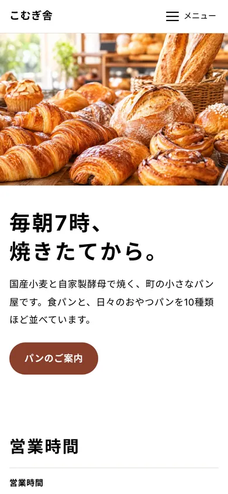
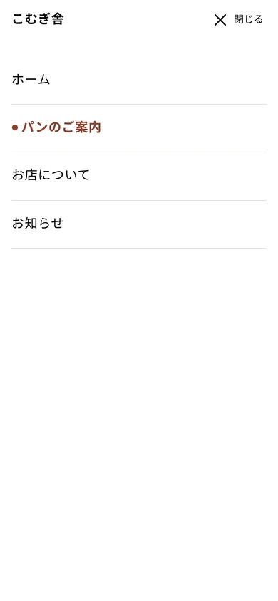
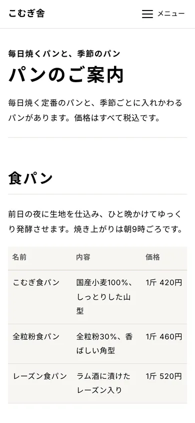
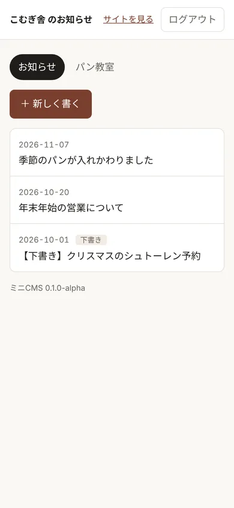
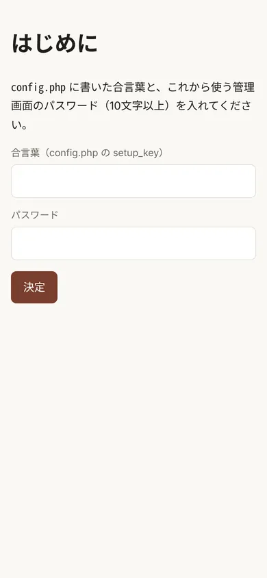
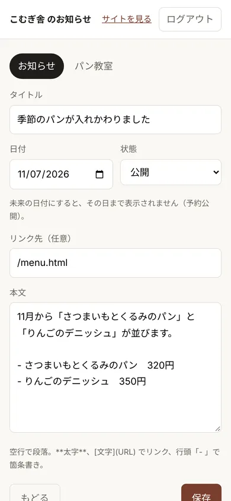

# しくみの解説

chibiweb v0.1 が、どう動いているかの説明です。
はじめて触る人と、未来の自分のために。

## 全体の考え方

このサイトは、2種類のページでできています。

- **ふだんは変わらないページ**：HTMLのまま置いてある（ホーム、パンのご案内、お店について）。直すときはAIと話しながら直す
- **よく変わる部分**：お知らせだけ。管理画面から書くと、ページの決まった場所に差し込まれる

WordPressは「全部のページを毎回組み立てる」しくみですが、chibiwebは「変わるところだけ動かす」しくみです。そのぶん軽く、壊れにくく、保守がほとんどいりません。
なぜこう作ったのかは、`FOR-MAKERS.md` に書いてあります。

## 見た目の部品



ホームは、SNSで写真を見てやってきた人が「お店に行く」までたどる順番に並んでいます。

1. メイン写真（天地は細め）
2. 緊急のお知らせ（臨時休業など。書いたときだけ出る）
3. お店のひとこと
4. 営業時間・定休日
5. アクセス（住所と地図）
6. お知らせ
7. パン教室
8. パンとお店のこと（ほかのページへの入口）

このうち「緊急のお知らせ」「お知らせ」「パン教室」の中身だけが、管理画面から書いたものです。ほかは静的HTMLです。
地図は、ホームの「アクセス」1か所だけに置いています（メニューの「アクセス」から飛べます）。

### ヘッダーとフッター



ヘッダー（ロゴとメニュー）とフッター（コピーライト）は、全ページ共通の「部品」です。
各ページのHTMLには、次の2行が書いてあるだけです。

```html
<site-header>…</site-header>
<site-footer></site-footer>
```

中身は `public/site.json` 1か所に書いてあり、そこを直すと全ページのメニューが変わります。
いま開いているページには、メニューに印（●）がつきます。

### 下層ページ



下層ページは、どれも同じ順番でできています。

1. ページの見出し（小さい1行目＋大きい本題）
2. 本文
3. ページ末の移動リンク

見出し・表・情報リスト・注意書きなどの部品の使い方は、`DESIGN.md` に書いてあります。

## お知らせが表示されるまで

```
管理画面で書く
   ↓
public/news/data/info/2026-11-07-a1b2c3.md として保存される（1件＝1ファイル）
   ↓
ページを開くと、embed.js が api.php に「最新3件ちょうだい」と頼む
   ↓
api.php が mdファイルを読んで、新しい順に返す
   ↓
embed.js が、ページの <div data-news> の場所に並べる
```

お知らせ1件はただのテキストファイルなので、管理画面を使わずに、AIやエディタで直接書いてもかまいません。

### 管理画面



`/news/admin/` を開くとログイン画面になります。上のタブで「お知らせ」「緊急のお知らせ」「パン教室」を切り替えます。タブ（チャンネル）は `news/config.php` で増やせます。

はじめて開いたときは、`config.php` に書いた合言葉（setup_key）と、これから使うパスワードを入れる画面になります。





- **日付を未来にすると**：その日になるまで公開されない（予約公開）
- **状態を「下書き」にすると**：公開側には出ない
- **削除すると**：完全には消えず、`data/_trash/` に移る（あとで取り戻せる）
- **緊急のお知らせは**：臨時休業の日が過ぎたら、下書きに戻すか削除する。残っているとホームの上に出続ける

管理画面の背景がクリーム色なのは、公開ページと見分けるためです。

## フォルダの分け方

```
chibiweb/
├─ public/      ← サーバーに上げるもの（この中身を、サイトのフォルダにそのまま入れる）
├─ docs/        ← 説明のmd（サーバーには上げない）
│   └─ img/     ← 説明用の画像
├─ photos/      ← 写真の元データ（サーバーには上げない）
├─ README.md          ← 最初に読む説明
├─ AGENTS.md          ← AIへの作業ルール
├─ CLAUDE.md          ← Claude用の入口（中身は AGENTS.md を読むだけ）
├─ CONTRIBUTING.md    ← 参加のしかた
├─ CODE_OF_CONDUCT.md ← 行動規範
├─ CHANGELOG.md       ← 変更の記録
└─ LICENSE
```

`README.md` や `AGENTS.md` などは一番上に置いています。GitHubは一番上の `README.md` を表紙として表示し、AIの道具の多くは一番上の `AGENTS.md` を探しに行くためです。

## 写真

- メイン写真は1枚。横幅 800・1600・2400px の3サイズを用意して、ブラウザが画面に合うものを選ぶ
- 元の写真は `photos/` に置き、AIが3サイズに変換して `public/assets/img/` に入れる
- 毎日変わる商品の写真はサイトでは扱わず、InstagramなどのSNSに任せる

## 安全のためにしていること

- 管理画面はパスワードつき。パスワードは元に戻せない形（ハッシュ）で `news/data/.auth.php` に保存
- 最初のパスワードは、`config.php` に書いた合言葉（setup_key）を知っている人しか決められない
- お知らせのデータフォルダは、外から直接は読めない（`.htaccess`）
- 本文に危ないリンク（`javascript:` など）を書いても、リンクにならない
- フォームには「なりすまし送信」を防ぐ確認がついている

くわしくは `SECURITY.md` へ。パスワードの強さの目安や、使う人ができることも書いてあります。

## まだできないこと（v0.1）

- 画像のアップロード
- 複数の人での管理
- PCで横並びのメニュー
- お知らせのラベル（「重要」など）

詳しくは `README.md` の「v0.1 でやらないこと」へ。決めていない先のことは `CHANGELOG.md` の「これから」にまとめています。
